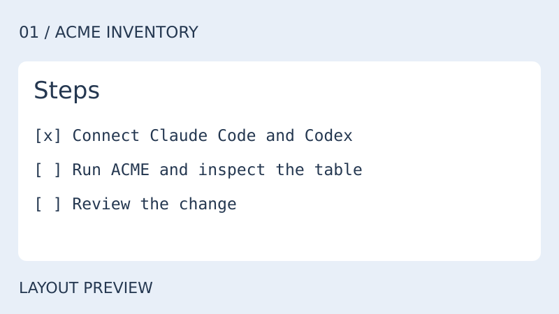
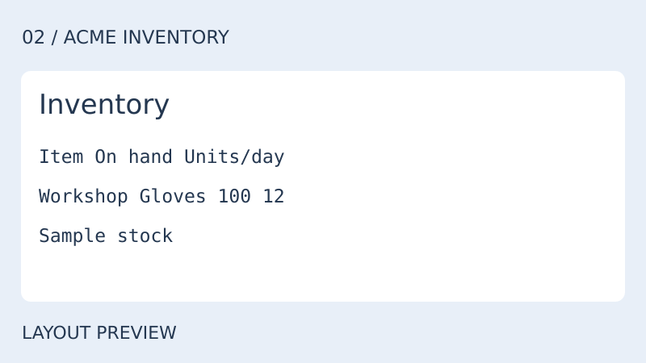
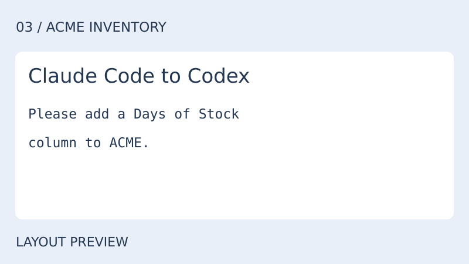
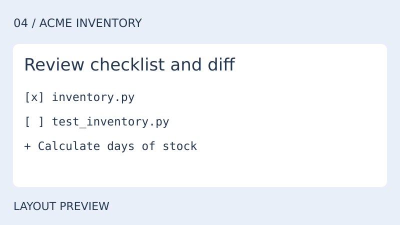
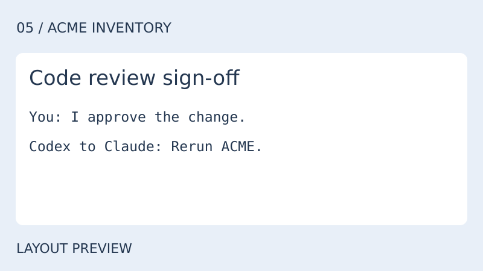
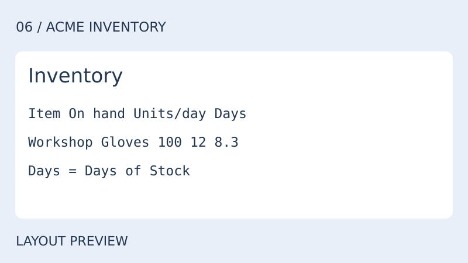

<h1 align="center">GitSense Chat</h1>

<h3 align="center">Same agents. More possibilities.</h3>

<p align="center">
  <a href="#quick-start">Quick start</a> &nbsp;·&nbsp;
  <a href="README-previous.md#runtime-details">Runtime details</a> &nbsp;·&nbsp;
  <a href="#give-yourself-and-your-agents-more-ways-to-collaborate">Work together</a> &nbsp;·&nbsp;
  <a href="README-previous.md#connect-agents-across-environments">Communicate</a> &nbsp;·&nbsp;
  <a href="README-previous.md#give-agents-a-better-starting-point">Share knowledge</a>
</p>

<p align="center">Your agents keep working where they are. GitSense Chat gives you more ways to work together.</p>

<a href="hero-combined-gap-arrow.png"></a>

## Quick start

Review the [install script](install.sh), then install the `gsc` CLI:

```bash
curl -fsSL https://raw.githubusercontent.com/gitsense/chat/refs/heads/main/install.sh | bash
```

To install and configure GitSense Chat, ask your coding agent:

```text
Install and configure GitSense Chat for me. Start by running `gsc docs help`.
```

You can also [build the CLI from source](https://github.com/gitsense/gsc-cli). See [Runtime details](README-previous.md#runtime-details) for Pi setup and bringing in sessions from other agents.

## Give yourself and your agents more ways to collaborate

Create a Group in GitSense Chat to give yourself and your agents a shared workspace. It's like a breakout room with whiteboards you can talk to. Ask your agent to update a table or show a different diff, then keep working from what's already in view. Your agents can do all of this from their own terminals.

In this demo, Claude Code puts the ACME inventory results in a table. You ask for a **Days of Stock** column, and Claude passes the request to Codex. You review the code with Codex, then Claude reruns the tool. The new column appears in the same table where you started.


*Video placeholder. Recording to come.*

<!-- Layout previews only. Replace all six with stills from the same recording. -->
<table>
  <tr>
    <td width="33%" valign="top"><br>1. Open the Steps card</td>
    <td width="33%" valign="top"><br>2. Inspect the inventory table</td>
    <td width="33%" valign="top"><br>3. Ask Claude to hand off the request</td>
  </tr>
  <tr>
    <td width="33%" valign="top"><br>4. Review the diff with Codex</td>
    <td width="33%" valign="top"><br>5. Sign off and ask Claude to rerun</td>
    <td width="33%" valign="top"><br>6. See the new column in the same table</td>
  </tr>
</table>

## Define how you and your agents can work together

Is AI overkill for a pizza party? Probably, but it's a familiar task for seeing how you, your agents and programs can work together in GitSense Chat. Start with pizza, then imagine your next code review, product launch or root cause analysis.

<!-- Draft layout: these are placeholder images, not playable videos. Replace with verified recordings and check captions before publication. -->

### Create your collaboration space

Agents need context, and so do you. Start the pizza party workflow and bring in your agents. Explore the available choices, then give each agent the saved information it needs for its part.


Explore what you can do next:

<table>
  <tr>
    <th width="50%">Work with the Steps agent</th>
    <th width="50%">Plan with an expert</th>
  </tr>
  <tr>
    <td width="50%" valign="top">
      
      <p>Edit the checklist yourself, then ask its agent to read your changes and help refine it.</p>
    </td>
    <td width="50%" valign="top">
      
      <p>Ask the expert to choose toppings, size and quantity, then review and adjust the selections directly in the builder.</p>
    </td>
  </tr>
  <tr>
    <th width="50%">Get another perspective</th>
    <th width="50%">Talk to your data</th>
  </tr>
  <tr>
    <td width="50%" valign="top">
      
      <p>Read each agent's review in its own pane, with their sign-offs recorded in Your Order.</p>
    </td>
    <td width="50%" valign="top">
      
      <p>Ask about restaurants and get recommendations in a new column beside each restaurant.</p>
    </td>
  </tr>
</table>

The restaurants in this demo are fictional. No order is placed.

What would you spread out, and where would you bring an agent in? [Workflow Builder](https://github.com/gitsense/workflows/blob/main/workflow-builder/README.md) can help you design your own workflow.
