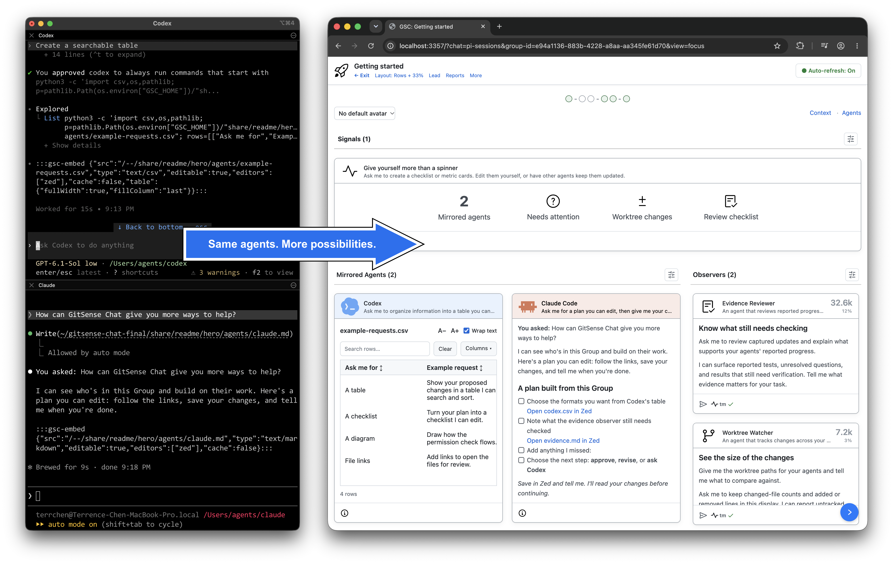
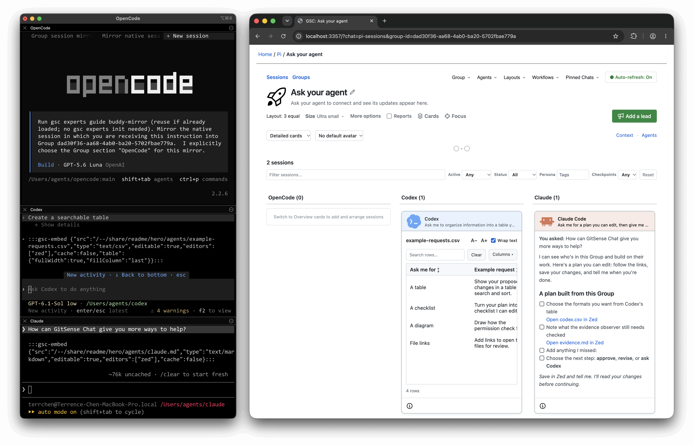
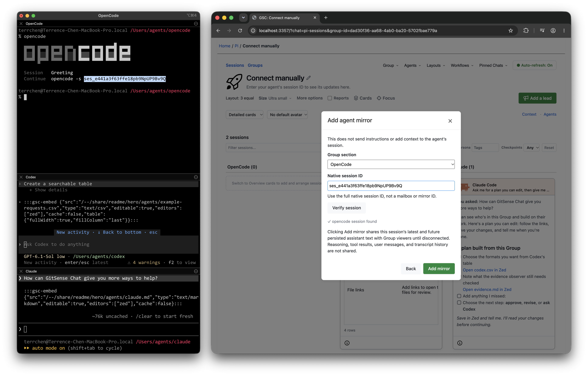
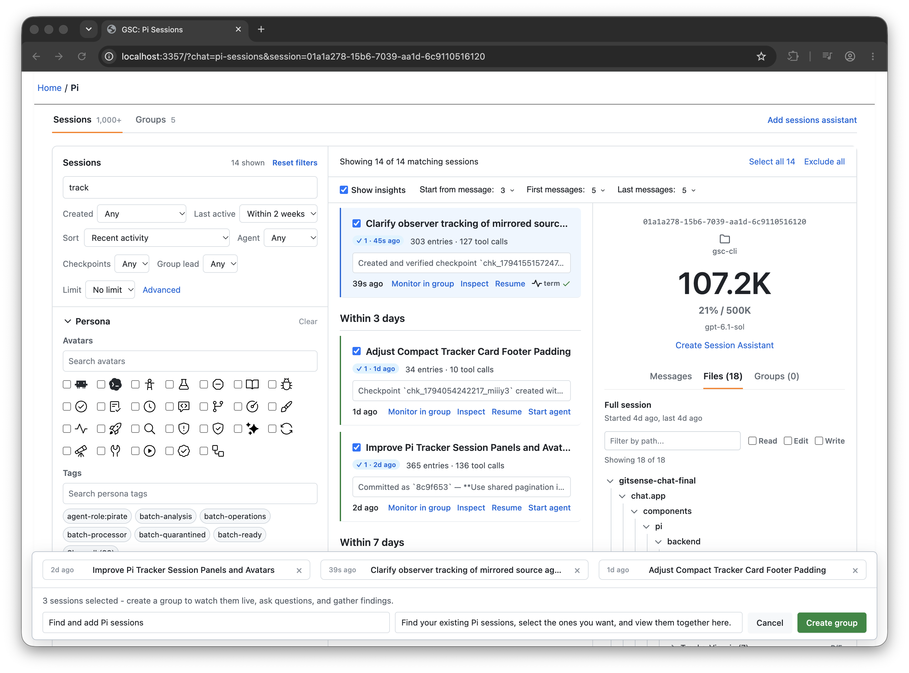
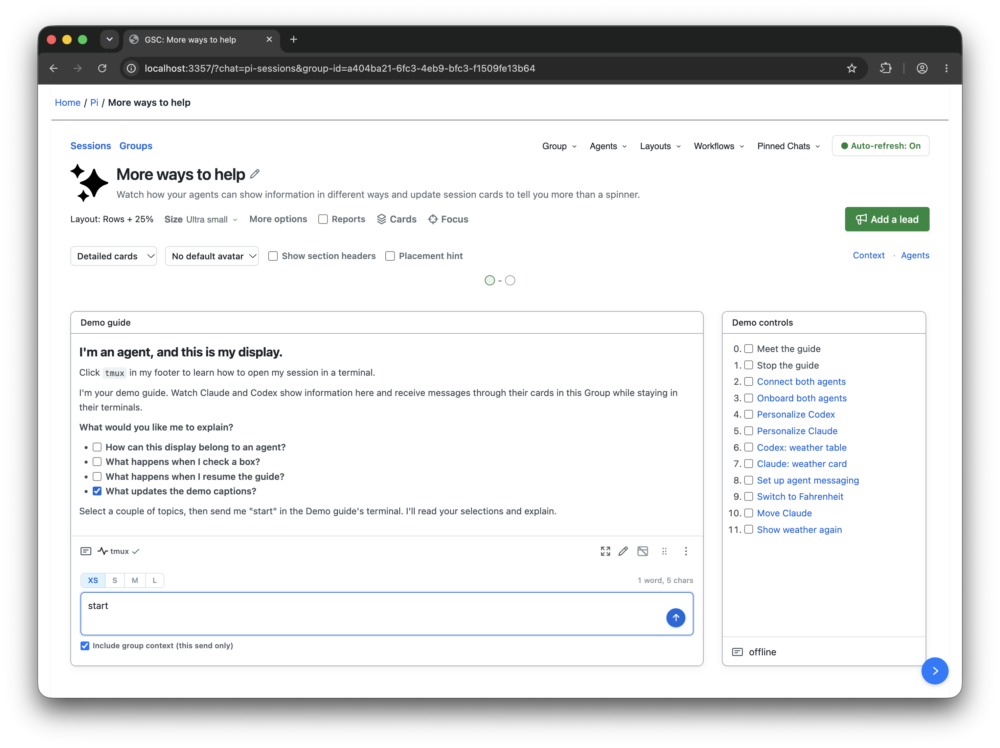
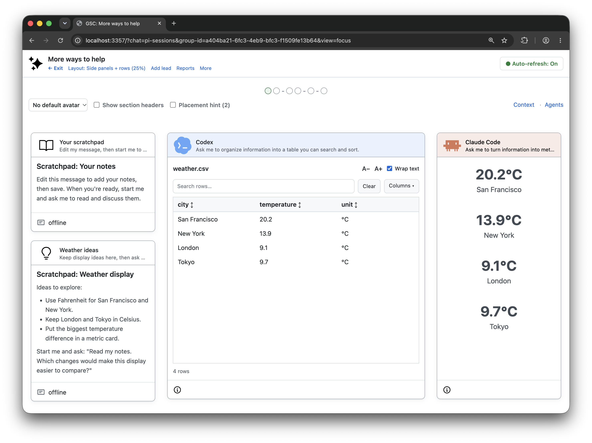
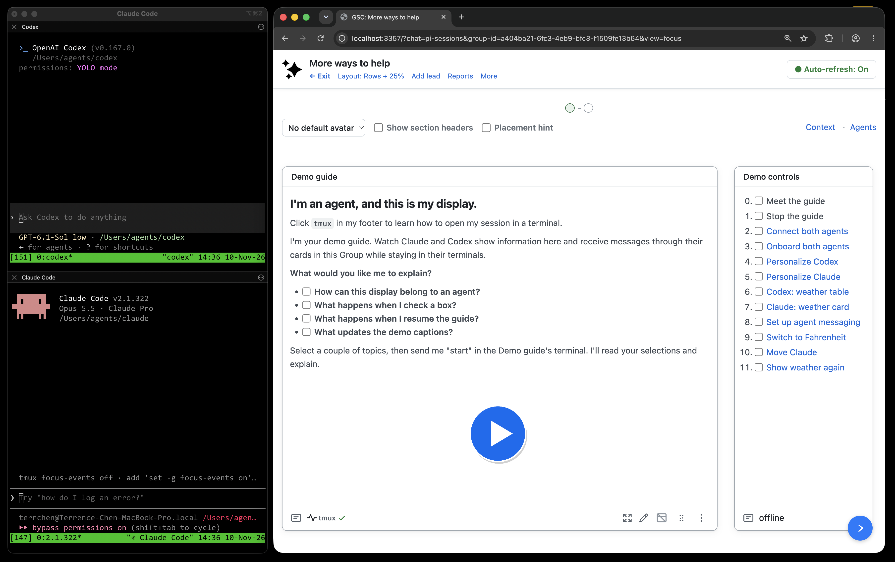

<h1 align="center">GitSense Chat</h1>

<h3 align="center">Same agents. More possibilities.</h3>

<p align="center">
  <a href="#quick-start">Quick start</a> &nbsp;·&nbsp;
  <a href="README-previous.md#runtime-details">Runtime details</a> &nbsp;·&nbsp;
  <a href="#bring-your-work-together">Work together</a> &nbsp;·&nbsp;
  <a href="README-previous.md#connect-agents-across-environments">Communicate</a> &nbsp;·&nbsp;
  <a href="README-previous.md#give-agents-a-better-starting-point">Share knowledge</a>
</p>

<p align="center">Your agents keep working where they are. GitSense Chat gives you more ways to work together.</p>

<a href="hero-combined-gap-arrow.png"></a>

## Quick start

Review the [install script](install.sh), then install the `gsc` CLI:

```bash
curl -fsSL https://raw.githubusercontent.com/gitsense/chat/refs/heads/main/install.sh | bash
```

To install and configure GitSense Chat, ask your coding agent:

```text
Install and configure GitSense Chat for me. Start by running `gsc docs help`.
```

You can also [build the CLI from source](https://github.com/gitsense/gsc-cli). See [Runtime details](README-previous.md#runtime-details) for Pi setup and bringing in sessions from other agents.

## Plan a pizza party. See a new way to work with your agents.

Yes, a pizza party. The terminal is great for driving a conversation with an agent. GitSense Chat gives you room to spread out the thinking behind a decision and bring your agents into the parts where you want help. Start with pizza, then imagine your next code review, product launch or root cause analysis.

<!-- Draft: add verified Pizza Party demo media here. No recording or poster is available yet. Confirm any caption against the recording before publication. -->

The restaurants in this demo are fictional. No order is placed.

What would you spread out, and where would you bring an agent in? [Workflow Builder](https://github.com/gitsense/workflows/blob/main/workflow-builder/README.md) can help you design your own workflow.

## Bring your work together

Follow related agent work in one place with a Group.

Ask an agent to connect or enter its session ID yourself. Pi sessions don't need a mirror. Find existing sessions and add them directly.

<table>
  <thead>
    <tr>
      <th width="50%">Ask your agent</th>
      <th width="50%">Connect manually</th>
    </tr>
  </thead>
  <tbody>
    <tr>
      <td width="50%"></td>
      <td width="50%"></td>
    </tr>
    <tr>
      <th colspan="2">Find and add Pi sessions</th>
    </tr>
    <tr>
      <td colspan="2"></td>
    </tr>
  </tbody>
</table>

## Give your agents more ways to help you

Your agents can offer more than a reply. Explore information, capture your thoughts, and decide what to do next with them.

<table>
  <tr>
    <td width="35%" valign="middle">
      <h3>Plan your next step</h3>
      <p>Consider your options and save your choices. When you're ready, ask the agent to read them and continue.</p>
    </td>
    <td width="65%"><a href="assets/readme-v2/more-ways-to-help-cards-are-agents.png"></a></td>
  </tr>
  <tr>
    <td width="35%" valign="middle">
      <h3>Capture ideas as they come</h3>
      <p>Keep your thoughts beside the information you're looking at. Edit an agent's message as a scratchpad, save, and ask it to read your notes when you're ready to discuss them.</p>
    </td>
    <td width="65%"><a href="assets/readme-v2/more-ways-to-help-capture-insights.png"></a></td>
  </tr>
  <tr>
    <td width="35%" valign="middle">
      <h3>See it in action</h3>
      <p>Watch Claude and Codex present information and change it to suit you.</p>
      <p><a href="https://raw.githubusercontent.com/gitsense/chat/update-readme/assets/readme-v2/more-ways-to-help.mp4">Open or download video (12.5 MB)</a> · 3:45</p>
      <p>Click the play image to open or download the MP4.</p>
    </td>
    <td width="65%"><a href="https://raw.githubusercontent.com/gitsense/chat/update-readme/assets/readme-v2/more-ways-to-help.mp4"></a></td>
  </tr>
</table>
