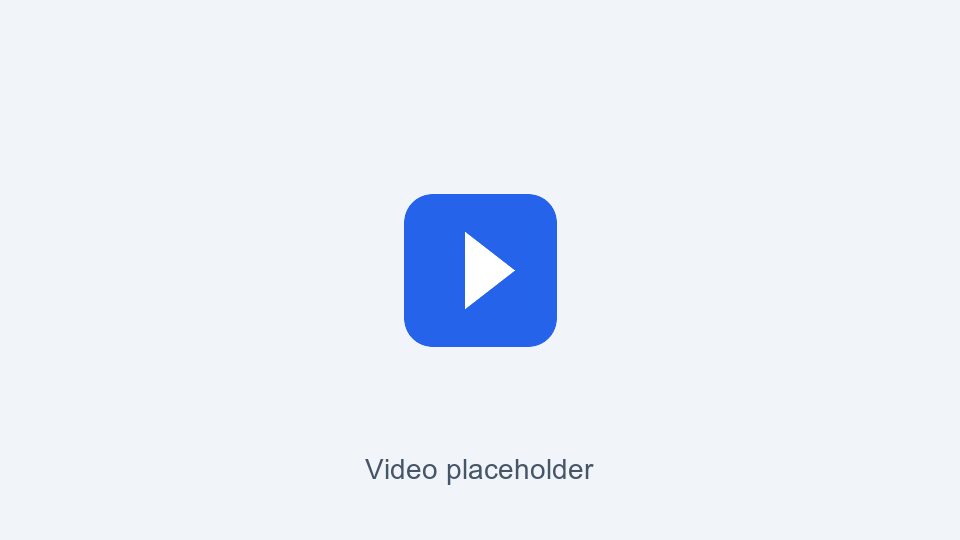

<h1 align="center">GitSense Chat</h1>

<h3 align="center">Same agents. More possibilities.</h3>

  <a href="README.md#quick-start">Quick start</a> &nbsp;·&nbsp;
  <a href="README.md#runtime-details">Runtime details</a> &nbsp;·&nbsp;
  <a href="README.md#work-together">Work together</a> &nbsp;·&nbsp;
  <a href="README.md#communicate">Communicate</a> &nbsp;·&nbsp;
  <a href="README.md#share-knowledge">Share knowledge</a>

Your agents keep working where they are. GitSense Chat gives you more ways to work together.

## Bring your work together

<table>
  <thead>
    <tr>
      <th width="50%">Ask your agent</th>
      <th width="50%">Connect manually</th>
    </tr>
  </thead>
  <tbody>
    <tr>
      <td width="50%"></td>
      <td width="50%"></td>
    </tr>
    <tr>
      <th colspan="2">Find and add Pi sessions</th>
    </tr>
    <tr>
      <td colspan="2"></td>
    </tr>
  </tbody>
</table>
