<h1 align="center">GitSense Chat</h1>

<h3 align="center">Same agents. More possibilities.</h3>

<p align="center">
  <a href="#quick-start">Quick start</a> &nbsp;·&nbsp;
  <a href="README-previous.md#runtime-details">Runtime details</a> &nbsp;·&nbsp;
  <a href="#give-yourself-and-your-agents-more-ways-to-collaborate">Work together</a> &nbsp;·&nbsp;
  <a href="README-previous.md#connect-agents-across-environments">Communicate</a> &nbsp;·&nbsp;
  <a href="README-previous.md#give-agents-a-better-starting-point">Share knowledge</a>
</p>

<p align="center">Your agents keep working where they are. GitSense Chat gives you more ways to work together.</p>

<a href="hero-combined-gap-arrow.png"></a>

## Quick start

Review the [install script](install.sh), then install the `gsc` CLI:

```bash
curl -fsSL https://raw.githubusercontent.com/gitsense/chat/refs/heads/main/install.sh | bash
```

To install and configure GitSense Chat, ask your coding agent:

```text
Install and configure GitSense Chat for me. Start by running `gsc docs help`.
```

You can also [build the CLI from source](https://github.com/gitsense/gsc-cli). See [Runtime details](README-previous.md#runtime-details) for Pi setup and bringing in sessions from other agents.

## Give yourself and your agents more ways to collaborate

Create a Group in GitSense Chat to give yourself and your agents a shared workspace. It's like a breakout room with whiteboards you can talk to. Ask your agent in its terminal to update a table or show a different diff, then see the change in Chat.

Watch how you can test and update the ACME inventory tool with Claude Code and Codex.


*Video placeholder. Recording to come.*

<!-- Layout previews only. These images are not screenshots from the recording. -->

### Start a Group when you need one

To create and join a Group, paste this into the agent you're already working with:

```text
Run gsc groups help, then create a Group in GitSense Chat and add yourself to it.
```

Bring another agent in when you need its help. In the ACME demo, Claude finds Codex in the Group and sends it your change request.

<table>
  <tr>
    <td width="33%" valign="top">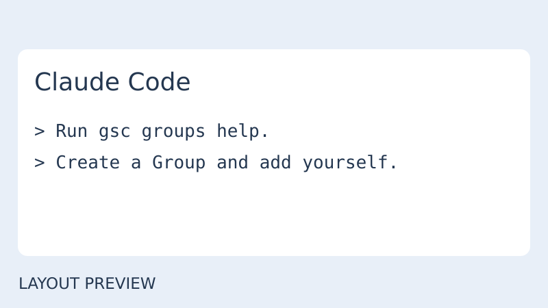<br>Ask your agent to start a Group</td>
    <td width="33%" valign="top">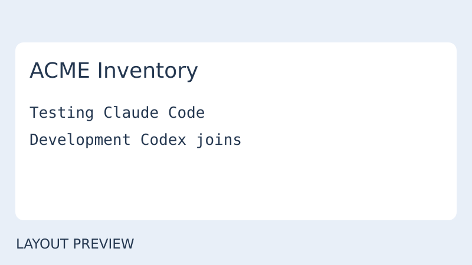<br>Bring another agent in later</td>
    <td width="33%" valign="top">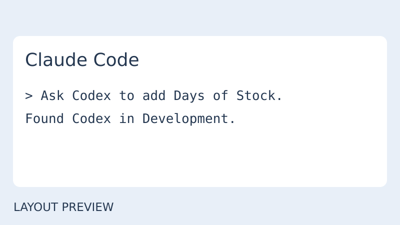<br>Say "Ask Codex"</td>
  </tr>
</table>

For agent-to-agent messaging in the demo, Claude Code and Codex run in tmux and register their inboxes with `gsc tmux inbox`.

### Keep what you need in view

Ask your agent to put the results you need to check beside the conversation. You can save decisions and mark what you've reviewed without searching earlier replies. Your agent can point Chat to a table file without reading its contents just to show it to you.

<table>
  <tr>
    <td width="33%" valign="top">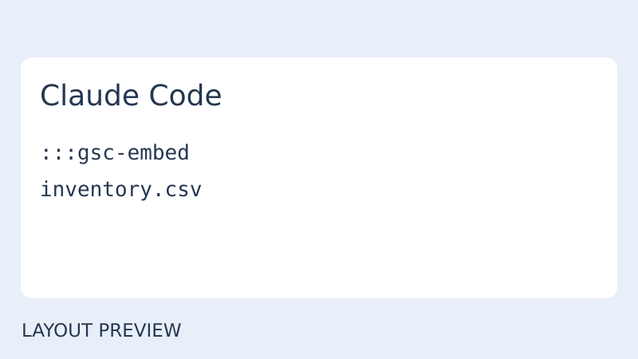<br>The agent references the results file</td>
    <td width="33%" valign="top">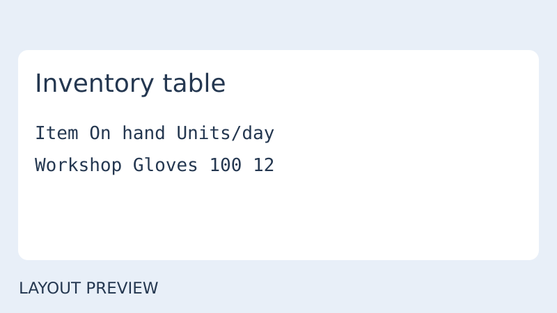<br>Chat displays the table</td>
    <td width="33%" valign="top">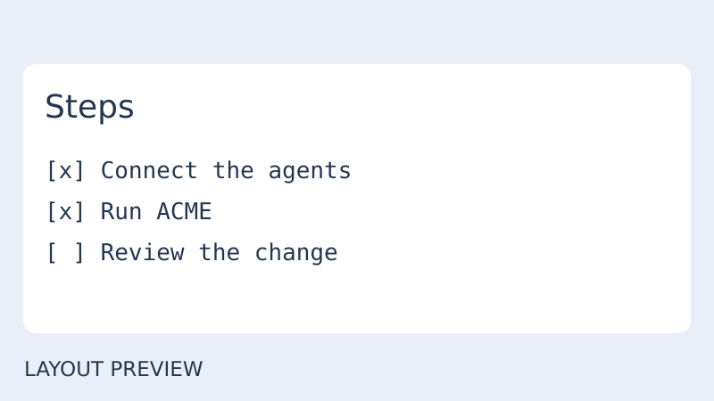<br>Keep review progress visible</td>
  </tr>
</table>

### Keep using the tools you know

Inspect a diff or table in Chat, then open it in your own tools. Open the same comparison in Zed, or use the table icon to open the CSV or TSV in a spreadsheet app you've set up.

<table>
  <tr>
    <td width="33%" valign="top">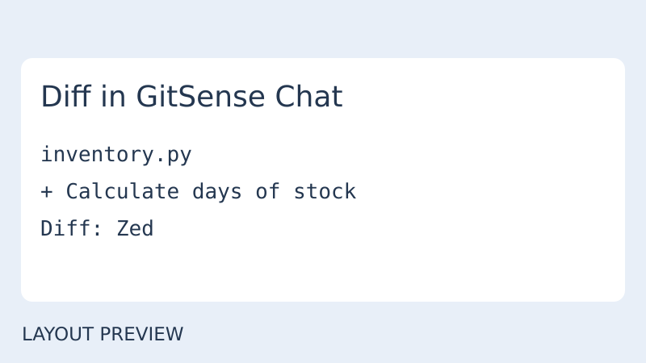<br>Start with the diff in Chat</td>
    <td width="33%" valign="top">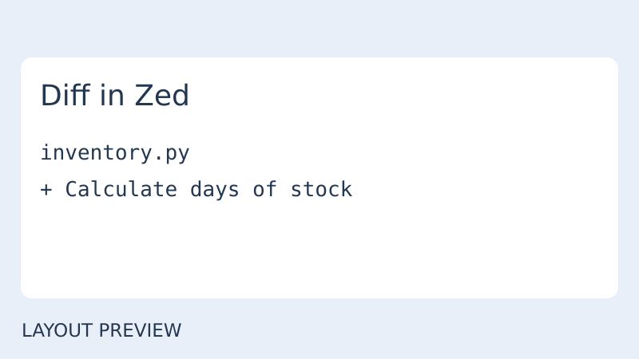<br>Open the same diff in Zed</td>
    <td width="33%" valign="top">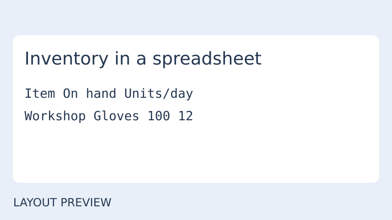<br>Open the table in your spreadsheet app</td>
  </tr>
</table>

## Define how you and your agents can work together

Is AI overkill for a pizza party? Probably, but it's a familiar task for seeing how you, your agents and programs can work together in GitSense Chat. Start with pizza, then imagine your next code review, product launch or root cause analysis.

<!-- Draft layout: these are placeholder images, not playable videos. Replace with verified recordings and check captions before publication. -->

### Create your collaboration space

Agents need context, and so do you. Start the pizza party workflow and bring in your agents. Explore the available choices, then give each agent the saved information it needs for its part.

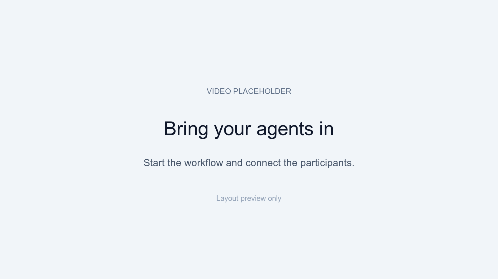

Explore what you can do next:

<table>
  <tr>
    <th width="50%">Work with the Steps agent</th>
    <th width="50%">Plan with an expert</th>
  </tr>
  <tr>
    <td width="50%" valign="top">
      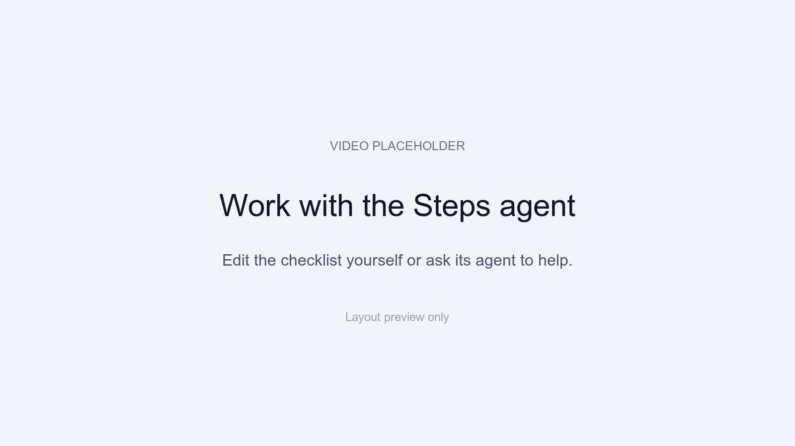
      <p>Edit the checklist yourself, then ask its agent to read your changes and help refine it.</p>
    </td>
    <td width="50%" valign="top">
      
      <p>Ask the expert to choose toppings, size and quantity, then review and adjust the selections directly in the builder.</p>
    </td>
  </tr>
  <tr>
    <th width="50%">Get another perspective</th>
    <th width="50%">Talk to your data</th>
  </tr>
  <tr>
    <td width="50%" valign="top">
      
      <p>Read each agent's review in its own pane, with their sign-offs recorded in Your Order.</p>
    </td>
    <td width="50%" valign="top">
      
      <p>Ask about restaurants and get recommendations in a new column beside each restaurant.</p>
    </td>
  </tr>
</table>

The restaurants in this demo are fictional. No order is placed.

What would you spread out, and where would you bring an agent in? [Workflow Builder](https://github.com/gitsense/workflows/blob/main/workflow-builder/README.md) can help you design your own workflow.
