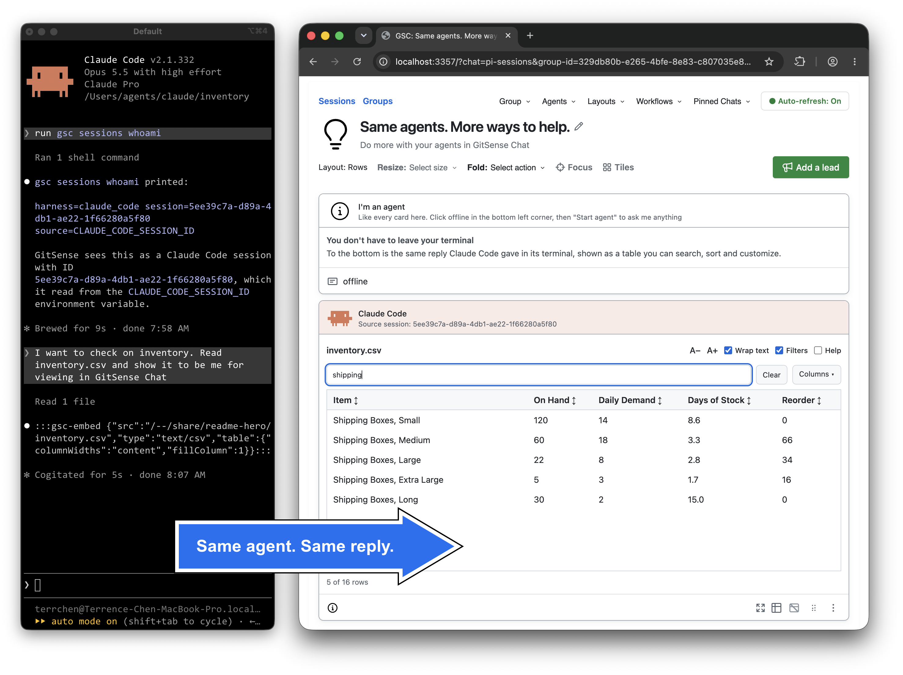
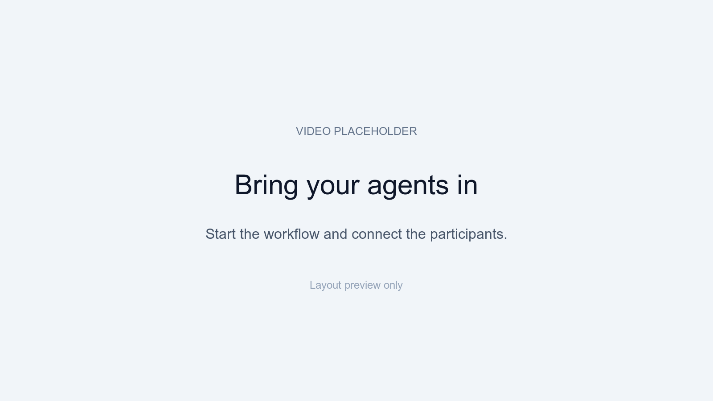
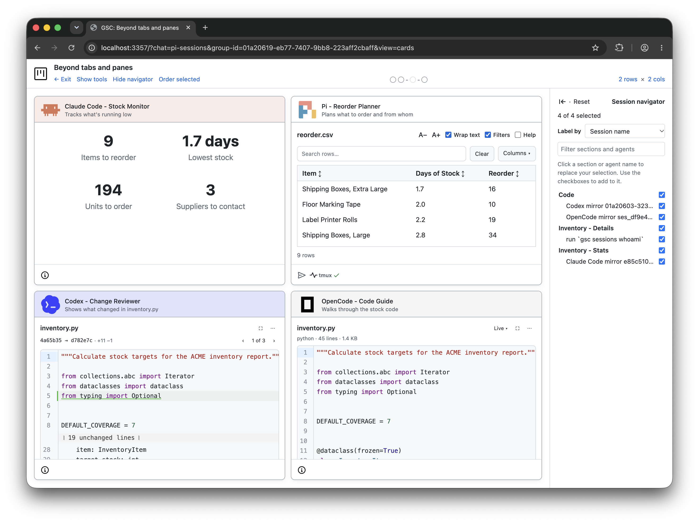
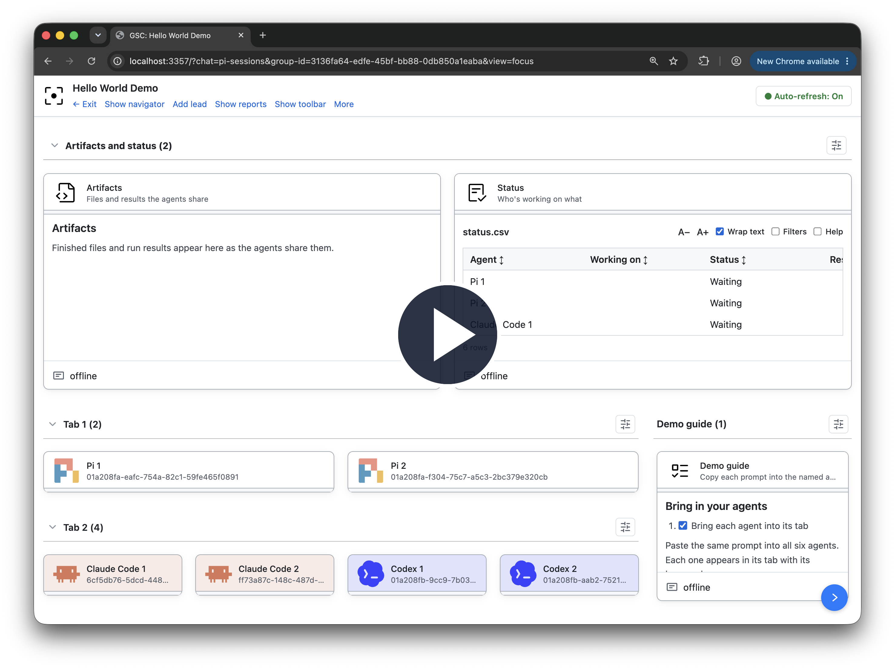
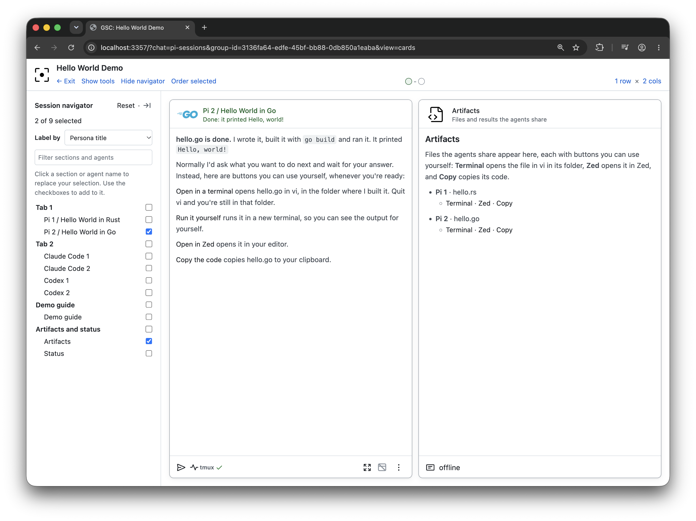

<h1 align="center">GitSense Chat</h1>

<h3 align="center">Same agents. More possibilities.</h3>

<p align="center">
  <a href="#quick-start">Quick start</a> &nbsp;·&nbsp;
  <a href="README-previous.md#runtime-details">Runtime details</a> &nbsp;·&nbsp;
  <a href="#keep-working-in-your-terminal-collaborate-in-gitsense-chat">Work together</a> &nbsp;·&nbsp;
  <a href="README-previous.md#connect-agents-across-environments">Communicate</a> &nbsp;·&nbsp;
  <a href="README-previous.md#give-agents-a-better-starting-point">Share knowledge</a>
</p>

<p align="center">Your agents keep working where they are. GitSense Chat gives you more ways to work together.</p>

<a href="assets/readme-hero-callout.png"></a>

## Quick start

Review the [install script](install.sh), then install the `gsc` CLI:

```bash
curl -fsSL https://raw.githubusercontent.com/gitsense/chat/refs/heads/main/install.sh | bash
```

To install and configure GitSense Chat, ask your coding agent:

```text
Install and configure GitSense Chat for me. Start by running `gsc docs help`.
```

You can also [build the CLI from source](https://github.com/gitsense/gsc-cli). See [Runtime details](README-previous.md#runtime-details) for Pi setup and bringing in sessions from other agents.

## Plan a pizza party with Claude Code, Codex and Pi

Give your agents a checklist and ask them to suggest an order. Adjust the selections yourself, then bring in another agent to review them.



*Video placeholder. Recording to come.*

[Learn how to design your own workflow with Workflow Builder](https://github.com/gitsense/workflows/blob/main/workflow-builder/README.md).

## Keep working in your terminal. Collaborate in GitSense Chat.

Create a Group in GitSense Chat to give yourself and your agents a shared workspace. It's like a breakout room with whiteboards you can talk to. Ask your agent in its terminal to update a table or show a different diff, then see the change in Chat.

### Start a Group at any point

You can ask your agent to start a Group even if you're halfway through a task. Keep talking in the same terminal session, and use the Group to see the results your agent shares as you go.

**Start a Group.** Paste this into the agent you're already working with:

```text
Run gsc groups help, then create a group named "Beyond tabs and panes" with the alias btp and add yourself
```

**Bring in another agent.** When you want another agent's help, give it the short alias `btp` instead of the Group ID.

```text
Run gsc groups help, then join the group btp
```


Then organize the Group in a way that makes sense to you. Name your sections, arrange the cards, and choose how to display them.

<table>
  <tr>
    <td width="33%" valign="top"><a href="assets/beyond-tabs-and-panes-home.png"></a><br>Home</td>
    <td width="33%" valign="top"><a href="assets/beyond-tabs-and-panes-focus.png"></a><br>Focus</td>
    <td width="33%" valign="top"><a href="assets/beyond-tabs-and-panes-tiles.png"></a><br>Tiles</td>
  </tr>
</table>

## Let your agents show you where things stand

The more agents you have working in parallel, the harder it can be to see what's still underway and what's ready to review. GitSense Chat gives you one place to follow the work. Your agents can post updates and share results in the Group while they keep working in their terminals.

Keep interacting with your agents the way you already do. GitSense Chat gives them a shared place to post progress, show results, and make their work easier for you to follow.

Watch six sessions from two terminal tabs come together in one Group. Two Pi agents keep working in their terminals, update their cards as they go, and share finished Rust and Go programs you can open from the Group.

<table>
  <tr>
    <td width="50%" valign="top"><a href="assets/hello-world-terminal-tab-1.png"></a><br>Terminal tab 1</td>
    <td width="50%" valign="top"><a href="assets/hello-world-terminal-tab-2.png"></a><br>Terminal tab 2</td>
  </tr>
</table>

<p align="center"><a href="assets/your-terminal-agents-in-gitsense-chat.mp4?raw=true">Download video (1:35, 8.5 MB)</a></p>

<a href="assets/your-terminal-agents-in-gitsense-chat.mp4?raw=true"></a>

<table>
  <tr>
    <td width="33%" valign="top"><a href="assets/hello-world-artifacts-and-status-done.png"></a><br><strong>More than spinners</strong></td>
    <td width="33%" valign="top"><a href="assets/hello-world-artifacts-and-status-done-tiles.png"></a><br><strong>Control the flow</strong></td>
    <td width="33%" valign="top"><a href="assets/hello-world-demo-done-resume-the-work.png"></a><br><strong>Jump to the work</strong></td>
  </tr>
</table>
