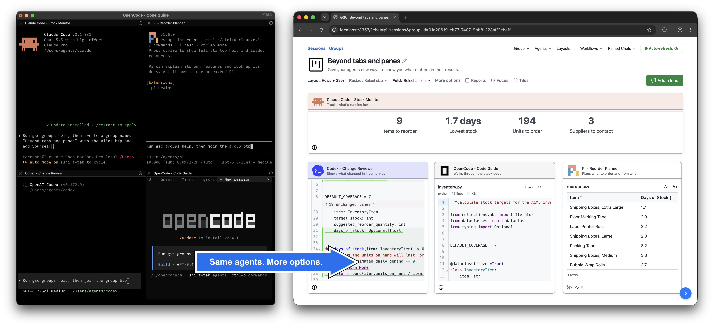
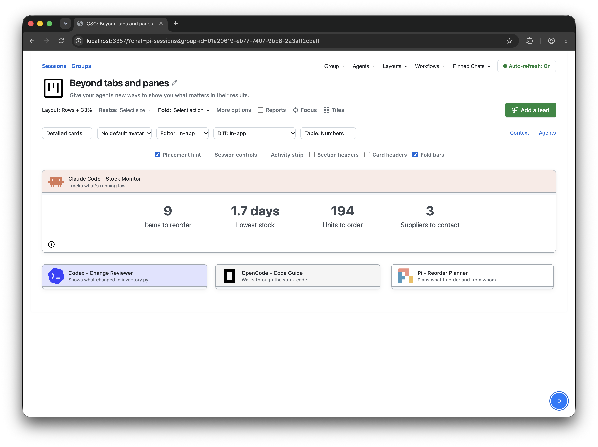
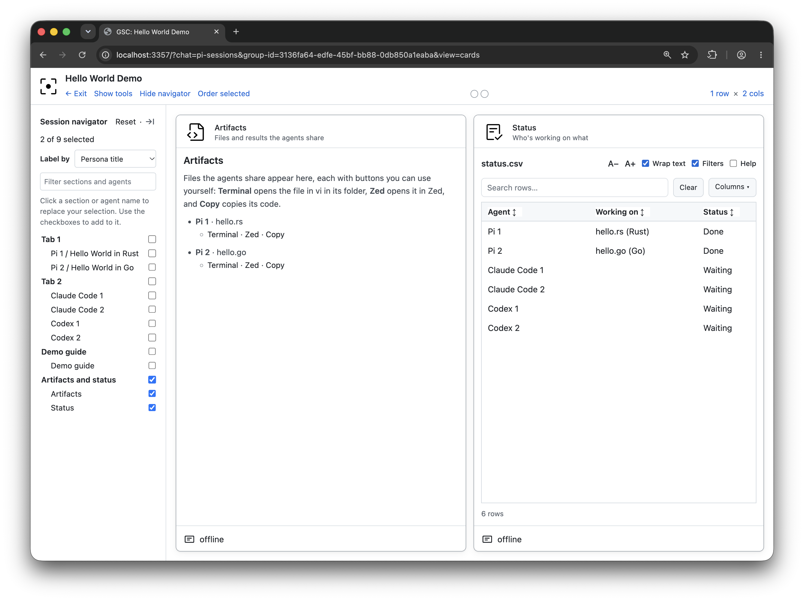

<h1 align="center">GitSense Chat</h1>

<h3 align="center">Same agents. More possibilities.</h3>

<p align="center">
  <a href="#quick-start">Quick start</a> &nbsp;·&nbsp;
  <a href="#runtime-details">Runtime details</a> &nbsp;·&nbsp;
  <a href="#keep-working-in-your-terminal-collaborate-in-gitsense-chat">Work together</a> &nbsp;·&nbsp;
  <a href="README-previous.md#connect-agents-across-environments">Communicate</a> &nbsp;·&nbsp;
  <a href="README-previous.md#give-agents-a-better-starting-point">Share knowledge</a>
</p>

<p align="center">Your agents keep working where they are. GitSense Chat gives you more ways to work together.</p>

<a href="assets/readme-hero-callout.png"></a>

## Quick start

Review the [install script](install.sh), then install the `gsc` CLI:

```bash
curl -fsSL https://raw.githubusercontent.com/gitsense/chat/refs/heads/main/install.sh | bash
```

To install and configure GitSense Chat, ask your coding agent:

```text
Install and configure GitSense Chat for me. Start by running `gsc docs help`.
```

You can also [build the CLI from source](https://github.com/gitsense/gsc-cli). See [Runtime details](#runtime-details) for Pi setup and bringing in sessions from other agents.

## Take part in the work, not just the conversation

Skills guide how your agents do a task. GitSense Chat gives you a place to shape how you work with them, and how involved you get is up to you.

You can [create a workflow](https://github.com/gitsense/workflows/blob/main/workflow-builder/README.md) that sets out who does what and when you step in. For a bug fix, you might ask your agent to show you what it found, then decide whether the fix belongs in the UI or the backend before it changes any code. A workflow can be a simple checklist you go through with one agent or a task you share with several, like planning a pizza party.

### Review code with Pi, Codex and Claude Code

*Demo in development.*

### Plan a pizza party with Pi, OpenCode, Claude Code and Codex

Yes, a pizza party. Make Pi the pizza lead and OpenCode the toppings expert. Give the lead the workflow to follow, then build your order with help from the toppings expert. Claude Code and Codex review it. The lead checks their sign-offs and the party's needs before deciding whether to show restaurant options.


*Demo preview. Recording to come.*

## Keep working in your terminal. Collaborate in GitSense Chat.

Create a Group in GitSense Chat to give yourself and your agents a shared workspace. It's like a breakout room with whiteboards you can talk to. Ask your agent in its terminal to update a table or show a different diff, then see the change in Chat.

### Start a Group at any point

You can ask your agent to start a Group even if you're halfway through a task. Keep talking in the same terminal session, and use the Group to see the results your agent shares as you go.

**Start a Group.** Paste this into the agent you're already working with:

```text
Run gsc groups help, then create a group named "Beyond tabs and panes" with the alias btp and add yourself
```

**Bring in another agent.** When you want another agent's help, give it the short alias `btp` instead of the Group ID.

```text
Run gsc groups help, then join the group btp
```

<a href="assets/beyond-tabs-and-panes-composite.png"></a>

### Focus on what matters

Arrange the Group around what you want to see. Fold cards in Home to keep the stock metrics in view, or use Focus and Tiles to see selected cards side by side.

<table>
  <tr>
    <td width="33%" valign="top"><a href="assets/beyond-tabs-and-panes-home-metrics.png"></a><br>Home</td>
    <td width="33%" valign="top"><a href="assets/beyond-tabs-and-panes-focus.png"></a><br>Focus</td>
    <td width="33%" valign="top"><a href="assets/beyond-tabs-and-panes-tiles.png"></a><br>Tiles</td>
  </tr>
</table>

## Let your agents show you where things stand

The more agents you have working in parallel, the harder it can be to see what's still underway and what's ready to review. GitSense Chat gives you one place to follow the work. Your agents can post updates and share results in the Group while they keep working in their terminals.

Keep interacting with your agents the way you already do. GitSense Chat gives them a shared place to post progress, show results, and make their work easier for you to follow.

Watch six sessions from two terminal tabs come together in one Group. Two Pi agents keep working in their terminals, update their cards as they go, and share finished Rust and Go programs you can open from the Group.

<table>
  <tr>
    <td width="50%" valign="top"><a href="assets/hello-world-terminal-tab-1.png"></a><br>Terminal tab 1</td>
    <td width="50%" valign="top"><a href="assets/hello-world-terminal-tab-2.png"></a><br>Terminal tab 2</td>
  </tr>
</table>

<p align="center"><a href="assets/your-terminal-agents-in-gitsense-chat.mp4?raw=true">Download video (1:35, 8.5 MB)</a></p>

<a href="assets/your-terminal-agents-in-gitsense-chat.mp4?raw=true"></a>

<table>
  <tr>
    <td width="33%" valign="top"><a href="assets/hello-world-artifacts-and-status-done.png"></a><br><strong>More than spinners</strong></td>
    <td width="33%" valign="top"><a href="assets/hello-world-artifacts-and-status-done-tiles.png"></a><br><strong>Control the flow</strong></td>
    <td width="33%" valign="top"><a href="assets/hello-world-demo-done-resume-the-work.png"></a><br><strong>Jump to the work</strong></td>
  </tr>
</table>

## Pi is the proof. Other agents next.

What if you could bring your agents' current sessions together and check what happened in a past one?

With Pi, you can. Select the sessions you're working in and click **Create group**. To find an earlier session, search for a phrase you remember or a file your agent worked on. Open **Inspect** to compare what you asked with what the agent did. Did it read the file you expected? What did the tool return? If you want to continue that conversation, use **Resume** to copy the command and run it in your terminal. You don't need a Group to review or resume a session.

Claude Code, Codex and OpenCode can already share replies in Groups while they run in their own terminals. We'd like to make their sessions just as easy to find, inspect and pick up again, where those tools support it.

## Runtime details

### Use Pi with Pi-Brains

GitSense indexes the history Pi saves locally so you can find and inspect past sessions. Install [Pi-Brains](https://github.com/gitsense/pi-brains) to connect Pi to GitSense:

```bash
pi install npm:@gitsense/pi-brains
```

Start Pi in a workspace and run `/brains`. Pi-Brains adds messaging, checkpoints, and live session status. The GitSense session sync service indexes the history Pi saves.

### Mirror sessions from other agents

Keep supported agents running in their own environments and mirror their updates into a Group. Ask your agent to use the Group's connection instructions, or enter its native session ID in GitSense Chat. For agent-guided setup, start with:

```bash
gsc experts guide buddy-mirror
```

Connecting requires your permission to share the session's latest saved assistant text and subsequent updates with Group viewers until you disconnect it. Mirrors do not publish reasoning, tool results, user messages, or transcript history. Connecting does not automatically make the agent read the Group or other agents' conversations.

Pi sessions don't need a mirror. Find existing Pi sessions in GitSense Chat and add them to a Group directly.

### Import a snapshot into Pi

Use [txcript](https://github.com/skillsynchq/txcript) to convert a session from Claude Code, Codex, or another supported agent into a Pi session. The CLI bootstrap installer installs the matching upstream binary into `~/.local/bin` on supported Unix platforms. You can also download it from [txcript Releases](https://github.com/skillsynchq/txcript/releases).

```bash
txcript list --from claude_code
txcript continue <session-id> \
  --from <harness> \
  --with pi \
  --no-resume
```

The converted snapshot appears in GitSense Chat after the Pi session sync service processes it. The snapshot captures the session at the time you import it. Repeat the conversion to refresh it.

## Security

GitSense Chat is designed for an individual's local agent workflow. It does not provide authentication or multi-user access controls.

Only make GitSense Chat available through the local loopback interface, such as `localhost` or `127.0.0.1`. Do not expose it directly to a local network or the public internet.

If you access GitSense Chat through a tunnel, restrict access to yourself and make sure the tunnel provides its own authentication. Treat anyone with access as having terminal-level access to your agent environment: they may be able to send messages to your agents, inspect session activity, and trigger actions allowed by your existing permissions.

## Current support and boundaries

Any agent that can run `gsc` can query the same Brains, notes, lessons, and rules without requiring runtime integration.

Executable actions remain subject to application authorization and command validation. GitSense Chat does not decide whether an agent's work is correct, and agent findings do not automatically become trusted knowledge. You decide what evidence to trust and what happens next.

## License

The [`gsc` CLI](https://github.com/gitsense/gsc-cli) is licensed under the [Apache License 2.0](https://www.apache.org/licenses/LICENSE-2.0).

Manifests are plain JSON files built on an open format. You can create, modify, distribute, and use them with the open-source `gsc` CLI without requiring GitSense Chat.

GitSense Chat is licensed under the [Fair Core License (FCL-1.0-ALv2)](https://fcl.dev/). You may use, modify, and run it internally, including for personal projects, shared workflows, and self-hosted deployments. You may not use it to build or operate a product or service that competes directly with GitSense Chat.

The core GitSense Chat application currently ships as minified source. We intend to open the source further as the project matures. Under the Fair Core License, each release becomes available under Apache 2.0 two years after it is published. See [LICENSE](LICENSE) and [NOTICE](NOTICE) for the complete terms.
