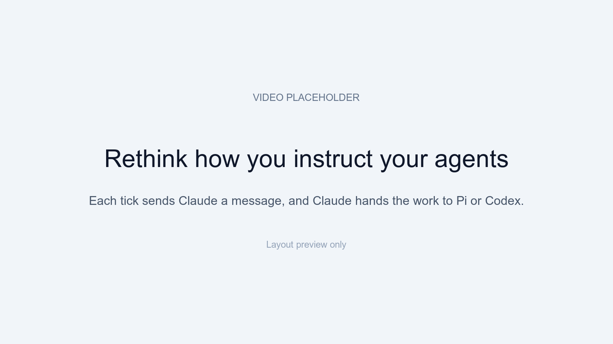
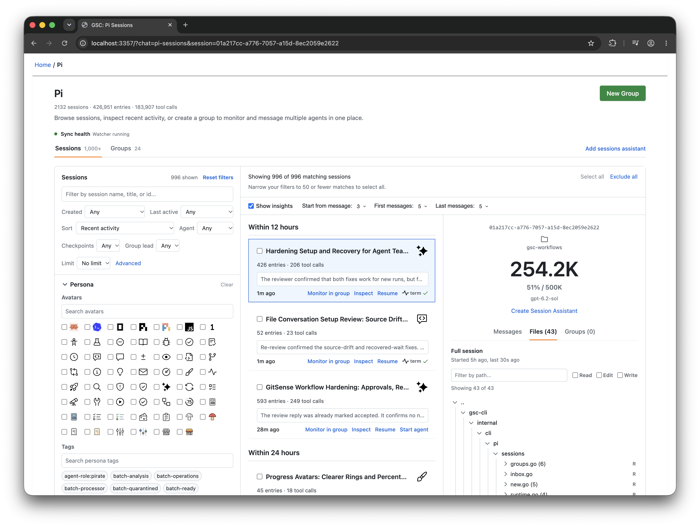
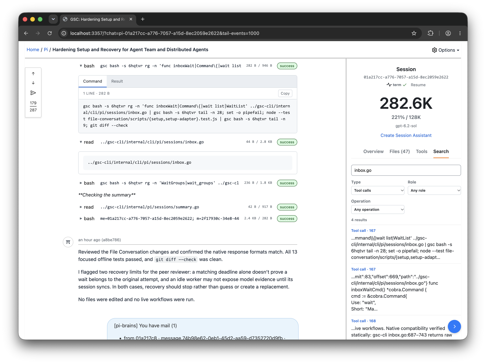
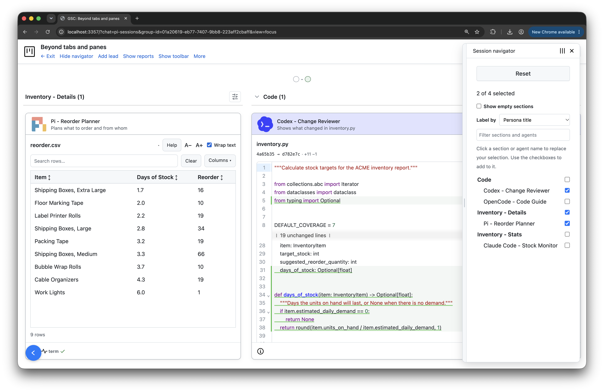

<h1 align="center">GitSense Chat</h1>

<h3 align="center">Same agents. More possibilities.</h3>

<p align="center">
  <a href="#quick-start">Quick start</a> &nbsp;·&nbsp;
  <a href="#a-meeting-place-for-you-and-your-agents">Work together</a> &nbsp;·&nbsp;
  <a href="#no-lock-in-pi-is-the-proof">Pi sessions</a> &nbsp;·&nbsp;
  <a href="#try-it-with-your-own-agents">Try it</a> &nbsp;·&nbsp;
  <a href="#current-support-and-boundaries">What works today</a>
</p>

<p align="center">Your agents keep working where they are. GitSense Chat is a local web app where you and your agents share results and decide what happens next.</p>

<a href="assets/readme-hero-callout.png"></a>

## Rethink how you instruct your agents and how they can help

**Watch what a tick can do.**

In the demo below, ticking a box in GitSense Chat sends Claude Code a message in its terminal telling it what to do next. Claude passes the steps to Pi and Codex, and Codex doesn't start until Pi is done, even if you tick too early. The checklist stays beside the work, so you can see what's next without opening a file.

**Watch how your agents can help.**

Pi and Codex post their progress to a Status table as they go, so you can follow along without reading their terminals. When Codex finishes, it leaves you more than a file: next to hey.rs in Artifacts is a link that opens the diff in Zed. Click it whenever you're ready, without asking Codex again.



*Demo preview. Recording to come.*

To set up your own checklist, ask your agent to run `gsc sessions hooks --help`. It will propose a hook program. The program runs as you, so review it before you turn it on.

## Quick start

Review the [install script](install.sh), then install the `gsc` CLI:

```bash
curl -fsSL https://raw.githubusercontent.com/gitsense/chat/refs/heads/main/install.sh | bash
```

`gsc` is the command-line tool your agents use. GitSense Chat is the app you open in your browser. To install and configure it, ask your coding agent:

```text
Install and configure GitSense Chat for me. Start by running `gsc docs help`.
```

You can also [build the CLI from source](https://github.com/gitsense/gsc-cli). See [Runtime details](#runtime-details) for Pi setup and bringing in sessions from other agents, and [Current support](#current-support-and-boundaries) for what each agent can do today.

## A meeting place for you and your agents

A terminal scrolls. A directory holds files. GitSense Chat adds Groups: breakout rooms for you and your agents. Any agent that can run [gsc](https://github.com/gitsense/gsc-cli) can post to a Group and read what others have posted. Ask an agent to pin a status table at the top, and the Group updates while you keep talking to the agent. You can put two results side by side, or add questions to a note and ask an agent to answer them.

Both demos below use a [workflow](https://github.com/gitsense/workflows/blob/main/workflow-builder/README.md) to tell the agents who does what and when to ask for your input.

### Any agent that can run `gsc` can contribute

Create a Group, and your agents can contribute from the terminals you already use by reading what's there and posting their own updates. Agents can also message each other directly: Pi through Pi-Brains, and Claude Code, Codex or OpenCode when they run in tmux.

In this code review demo, you bring together Claude Code, Codex and Pi. Claude Code asks the other two to review the same change independently. They post progress updates to the Group and write up their findings privately, and Claude Code checks the findings before adding them to the Group. You compare the findings with the diff and decide whether the file needs changes.

*Demo in development.*

### Take part in the work, not just the conversation

Build a pizza order for a party in the Group, with OpenCode as your toppings expert. Yes, a pizza party. Give Pi the workflow to follow as pizza lead. Claude Code and Codex review the order you put together. Pi checks their sign-offs and the party's needs before deciding whether to show restaurant options.


*Demo preview. Recording to come.*

## No lock-in. Pi is the proof.

Pi saves your sessions locally, and you can resume them in Pi without opening GitSense Chat. Reach for GitSense Chat when you want to:

- Search your sessions for "bug", create a Group from the matches, and add a lead agent to help you review them.
- Open a session's Inspect view to see tool calls and their results.
- Message a running Pi session from GitSense Chat and follow its replies as they come in.
- Copy a Resume command and run it in your terminal to pick up the conversation.

<a href="assets/pi-sessions-page.png"></a>

The panel on the right shows the selected session's token count and the files it read.

<table>
  <tr>
    <td width="33%" valign="top"><a href="assets/pi-session-files.png"></a><br><strong>Files</strong><br>Filter by a file name to see each read and edit the session made to it, and when.</td>
    <td width="33%" valign="top"><a href="assets/pi-session-error.png"></a><br><strong>Errors</strong><br>See which tool calls failed. Open one to review its command and result, and copy either one.</td>
    <td width="33%" valign="top"><a href="assets/pi-session-search.png"></a><br><strong>Search</strong><br>Search the session for text, such as inbox.go, and narrow the results to tool calls.</td>
  </tr>
</table>

Your other agents can join in too. Tell Claude Code, Codex or OpenCode to run `gsc experts init` and join your Group, then ask it to show a diff in its reply. You can review the diff in the Group next to what your other agents shared. `gsc experts init` starts your agent with a short overview, and it reads more only when a task needs it.

Replies can also include links that open a file in your editor, so you can jump back to the tools you already use.

We'd like to make other agents' sessions as easy to find, inspect and resume as Pi's, where those tools support it.

## Try it with your own agents

After you finish the [Quick start](#quick-start), you can try a Group with the agents you already have open.

### Start a Group at any point

You can ask your agent to start a Group even if you're halfway through a task. Keep talking in the same terminal session, and use the Group to see the results your agent shares as you go.

**Start a Group.** Paste this into the agent you're already working with:

```text
Run gsc groups help, then create a group named "Beyond tabs and panes" with the alias btp and add yourself.
```

**Bring in another agent.** When you want another agent's help, give it the short alias `btp` instead of the Group ID.

```text
Run gsc groups help, then join the group btp.
```

<a href="assets/beyond-tabs-and-panes-composite.png"></a>

Here, Claude Code, Pi, Codex and OpenCode each joined `btp` from their own terminal pane and shared one result in the Group: stock metrics, a diff, source code and a reorder table.

### Arrange the Group around what you want to see

In this Group, each agent has its own card. Choose how you want to see them:

<table>
  <tr>
    <td width="33%" valign="top"><a href="assets/beyond-tabs-and-panes-home-metrics.png"></a><br><strong>Home</strong><br>Fold the cards you don't need right now. The stock metrics stay open, and the other three are folded.</td>
    <td width="33%" valign="top"><a href="assets/beyond-tabs-and-panes-focus.png"></a><br><strong>Focus</strong><br>Pick the cards you want to see together. The stock metrics sit above the reorder table.</td>
    <td width="33%" valign="top"><a href="assets/beyond-tabs-and-panes-tiles.png"></a><br><strong>Tiles</strong><br>See every card at once, here in a two-by-two grid.</td>
  </tr>
</table>

## Runtime details

### Use Pi with Pi-Brains

The Pi session sync service in GitSense Chat indexes the history Pi saves locally, so you can find and inspect past sessions. Install [Pi-Brains](https://github.com/gitsense/pi-brains) to connect Pi to GitSense Chat:

```bash
pi install npm:@gitsense/pi-brains
```

Start Pi in a workspace and run `/brains`. Pi-Brains adds messaging, checkpoints and live session status.

### Mirror sessions from other agents

Keep supported agents running in their own environments and mirror their updates into a Group. Mirrors read sessions through [txcript](#import-a-snapshot-into-pi), so install it first. Ask your agent to use the Group's connection instructions, or enter the agent's own session ID in GitSense Chat. For agent-guided setup, start with:

```bash
gsc experts guide buddy-mirror
```

Connecting needs your permission. Once a session is connected, the Group shows its latest saved reply and each reply after that, until you disconnect. Mirrors don't share reasoning, tool results, your messages or the rest of the conversation. Connecting also doesn't make the agent read the Group or other agents' conversations.

Pi sessions don't need a mirror. Find existing Pi sessions in GitSense Chat and add them to a Group directly.

### Import a snapshot into Pi

Use [txcript](https://github.com/gitsense/txcript) to convert a session from Claude Code, Codex or another supported agent into a Pi session. GitSense maintains this fork with fixes that `gsc` needs, so use it instead of the upstream package. Build it from source with Rust 1.96 or newer, and make sure `~/.cargo/bin` is on your `PATH`:

```bash
cargo install --git https://github.com/gitsense/txcript txcript-cli --locked
```

Then convert a session:

```bash
txcript list --from claude_code
txcript continue <session-id> \
  --from claude_code \
  --with pi \
  --no-resume
```

The converted snapshot appears in GitSense Chat after the Pi session sync service processes it. The snapshot captures the session at the time you import it. Repeat the conversion to refresh it.

## Security

GitSense Chat is built for one person running their own agents on their own machine. It has no authentication and no multi-user access controls.

Only make GitSense Chat available through the local loopback interface, such as `localhost` or `127.0.0.1`. Do not expose it directly to a local network or the public internet.

If you access GitSense Chat through a tunnel, restrict access to yourself and make sure the tunnel provides its own authentication. Treat anyone with access as having terminal-level access to your agent environment: they may be able to send messages to your agents, inspect session activity, and trigger actions allowed by your existing permissions.

## Current support and boundaries

Your agents can query the same Brains, notes, lessons and rules through `gsc`, with no wrapper or proxy. A Brain is a database `gsc` can search. Some Brains describe your code, such as each file's purpose. Others hold the rules, notes and lessons you save.

| What you can do | Pi | Claude Code, Codex, OpenCode |
| :--- | :--- | :--- |
| Query Brains, notes, lessons and rules | Yes | Yes |
| Join a Group and post to it | Yes | Yes |
| Message other agents | Yes, with Pi-Brains | When running in tmux |
| Show replies in a Group | Add the session to the Group | [Mirror the session](#mirror-sessions-from-other-agents) |
| Find, inspect and resume sessions in GitSense Chat | Yes | Not yet |

An action button or form in an agent's reply doesn't grant any permission on its own. GitSense Chat checks whether the action is allowed and validates the command before it runs.

GitSense Chat doesn't decide whether an agent's work is correct, and agent findings don't become trusted knowledge automatically. You decide what evidence to trust and what happens next.

## License

The [`gsc` CLI](https://github.com/gitsense/gsc-cli) is licensed under the [Apache License 2.0](https://www.apache.org/licenses/LICENSE-2.0).

Manifests, the plain JSON files that Brains are built from, use an open format. You can create, modify, distribute and use them with the open-source `gsc` CLI without requiring GitSense Chat.

GitSense Chat is licensed under the [Fair Core License (FCL-1.0-ALv2)](https://fcl.dev/). You may use, modify and run it internally, including for personal projects, shared workflows and self-hosted deployments. You may not use it to build or operate a product or service that competes directly with GitSense Chat.

The core GitSense Chat application currently ships as minified source. We intend to open the source further as the project matures. Under the Fair Core License, each release becomes available under Apache 2.0 two years after it is published. See [LICENSE](LICENSE) and [NOTICE](NOTICE) for the complete terms.
